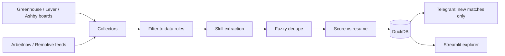

# Job Radar

**Live report:** https://job-radar-dashboard.streamlit.app/

A small pipeline that collects data engineering jobs from **legal public sources**, removes duplicates, scores each job against a resume profile, and sends the best new matches to Telegram every morning.

It does not scrape LinkedIn or Indeed. It reads only public job board APIs and open feeds that are meant for reuse.


## How it works



| Step | What it does | Why it is built this way |
| --- | --- | --- |
| Collect | One small parser per API, a pure function from JSON to `Job` | Parsers are tested on saved responses, so tests need no network. A failing source is logged and skipped. |
| Dedupe | Same URL, or same company with near-identical titles (RapidFuzz, `Sr.` = `Senior`) | The same role often shows up on several sources. |
| Score | 70% weighted skill coverage, 15% seniority, 10% location, 5% freshness; junior roles cut to 40% | A transparent formula you can explain and tune in `config/profile.yaml`. |
| Store | DuckDB keyed on `job_id` | "New" means first time seen, so an alert is never sent twice. |
| Alert | Telegram message for new jobs above `alert_min_score` | Silent when no token is set. |

## Run it

See [HOW_TO_RUN.md](HOW_TO_RUN.md). Short version:

```bash
pip install -r requirements.txt
PYTHONPATH=src pytest -q            # 9 tests, no network
python scripts/make_demo_data.py    # builds the sample report data
streamlit run app/streamlit_app.py
```

## Make it yours

Edit `config/profile.yaml` (your skills, locations, alert threshold) and `config/companies.yaml` (company board tokens).

Part of a series of six portfolio projects: https://agshivam.github.io
